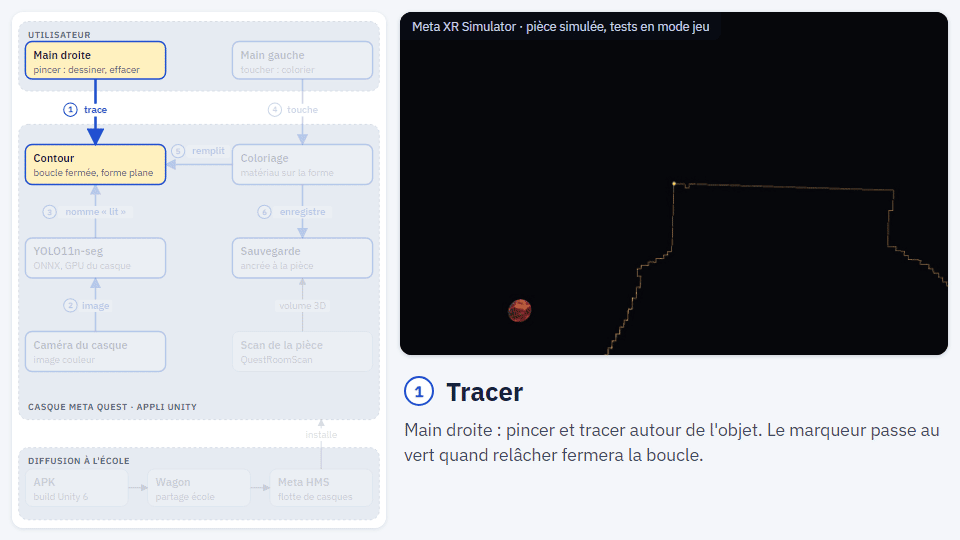

[English](README.md) · **Français**

# Color Your Reality

**Dessiner le contour d'un objet réel dans un casque Meta Quest : l'application le nomme, puis on le colorie.** Tout tourne dans le casque, reconnaissance de l'objet comprise.

Animation en français

*Tracer le contour d'un lit, le nommer, le colorier, dans le Meta XR Simulator. [Vidéo complète (1:16)](https://drive.google.com/file/d/1avJORNWjeER0pkDFkrrs19hgJAGHAO3R/view)*

## Ce qu'on fait avec

- **Dessiner.** Main droite, pincement pouce et index maintenu : on trace autour d'un objet. Le marqueur passe au vert quand relâcher fermera la boucle ; un son le confirme. Aux manettes, la gâchette remplace le pincement.
- **Nommer.** YOLO11n-seg lit l'image de la caméra ; le masque qui recouvre le mieux la boucle donne le nom de l'objet (par exemple « lit »). Seuls les objets courants reçoivent un nom (lit, chaise, écran, table…).
- **Colorier.** Main gauche : toucher la forme la remplit du matériau en cours. Pouce et auriculaire : matériau suivant.
- **Retoucher.** Pouce et auriculaire de la main droite font défiler Dessiner, Effacer (la partie balayée par le pincement) et Supprimer (la forme entière). Une étiquette au-dessus de chaque main indique son outil.
- **Masquer.** Le bouton menu de la manette gauche, ou le geste système de la main gauche, masque ou affiche les contours ; la couleur reste.
- **Reprendre.** Formes, traits et couleurs sont enregistrés dans le casque, ancrés à la pièce. Au lancement : reprendre ou repartir d'une pièce neuve.

## Architecture

Diagramme en français

## État

- **Casques.** La version 1.5.8 est publiée sur la flotte de casques Quest de l'école par Meta Horizon Managed Services, l'APK hébergée sur le partage de fichiers de l'école (Wagon). La version 1.5.9 (étiquettes des mains) est sur un seul casque de test. État d'octobre 2026.
- **Tests.** 90 tests de l'éditeur sur 91 passent. Les scénarios en mode jeu tournent sur le Meta XR Simulator ; les gestes aux manettes et le bouton menu se vérifient au casque.
- **Versions.** Jusqu'à la 1.4.3, l'application détectait seule les objets dans le scan de la pièce ; les contours sortaient lents et irréguliers, alors les versions suivantes laissent l'utilisateur les dessiner.
- **Technos.** Unity 6, Meta XR SDK, QuestRoomScan, Unity Inference Engine (GPU), YOLO11n-seg au format ONNX.

---

**Anthony Hunt** · [ingevision.cloud](https://ingevision.cloud/?p=color-your-reality) · [LinkedIn](https://www.linkedin.com/in/anthony-hunt-3948a9196) · [GitHub](https://github.com/anthohunt)

Le code et l'application restent dans le dépôt privé de l'école.
