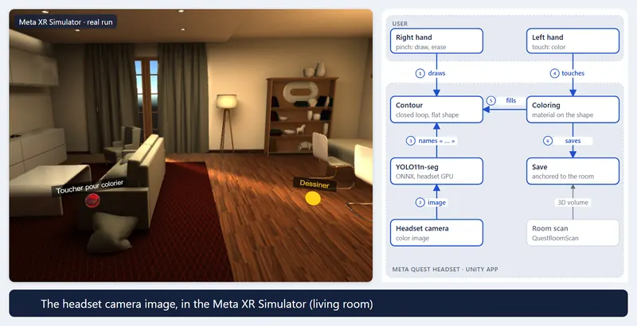
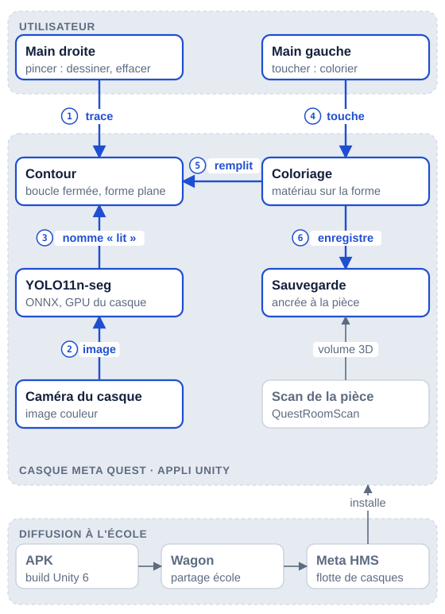

**English** · [Français](README.fr.md)

# Color Your Reality

**Draw the outline of a real object in a Meta Quest headset: the app names it, then you color it in.** Everything runs on the headset, object recognition included.

French version

*Tracing around a chair and a sofa, naming them, touching them to color them in, in the Meta XR Simulator (living room). [Full video (1:20)](https://drive.google.com/file/d/1zLNwWatbaI9cSe1nty7TUV8rVXNCQdTr/view)*

## Using it

- **Draw.** Right hand, thumb and index pinch held: trace around an object. The marker turns green when releasing will close the loop; a sound confirms it. With controllers, the trigger replaces the pinch.
- **Name.** YOLO11n-seg reads the camera image; the mask that best covers the loop names the object, in French (*lit* for a bed). Only common objects get a name (bed, chair, screen, table…).
- **Color.** Left hand: touch the shape to fill it with the current material. Thumb and little finger: next material.
- **Edit.** Thumb and little finger on the right hand cycle Draw, Erase (the part the pinch passes over) and Delete (the whole shape). A label above each hand shows its tool.
- **Hide.** The left controller's menu button, or the left hand's system gesture, hides or shows the outlines; the color stays.
- **Resume.** Shapes, strokes and paint are saved on the headset, anchored to the room. At launch: resume or start a new room.

## Architecture

French version

*App labels are in French.*

## Status

- **Headsets.** Version 1.5.8 is published to the school's Quest fleet through Meta Horizon Managed Services, the APK hosted on the school's file share (Wagon). Version 1.5.9 (hand labels) is on one test headset. State as of October 2026.
- **Tests.** 90 of 91 editor tests pass. Play-mode scenarios run on the Meta XR Simulator; controller gestures and the menu button are checked on a real headset.
- **Versions.** Up to 1.4.3 the app detected objects by itself in the room scan; outlines came out slow and ragged, so later versions let the user draw them.
- **Stack.** Unity 6, Meta XR SDK, QuestRoomScan, Unity Inference Engine (GPU), YOLO11n-seg in ONNX.

---

**Anthony Hunt** · [ingevision.cloud](https://ingevision.cloud/?lang=en&p=color-your-reality) · [LinkedIn](https://www.linkedin.com/in/anthony-hunt-3948a9196) · [GitHub](https://github.com/anthohunt)

The code and the app stay in the school's private repository.
